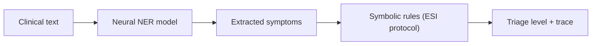

# Medical Triage

A neuro-symbolic medical triage system: neural NER extracts symptoms from clinical text, symbolic rules evaluate triage protocols.

**Source:** `examples/neuro_symbolic/medical_triage.sigil`

---

## What we're building

An Emergency Severity Index (ESI) triage system that classifies patients into 5 acuity levels based on symptoms and vital signs. Neural models extract symptoms from free-text clinical notes; symbolic rules apply the ESI protocol deterministically.

---

## Full source

```sigil
module examples.medical_triage

import python transformers

-- Types
type PatientInfo is record: -- (1)!
  text: Text
  symptoms: list of Text
  severity: Symbol
  age: Number
  vital_signs: record:
    heart_rate: Number
    blood_pressure_systolic: Number
    temperature: Number
    oxygen_saturation: Number

type TriageLevel is one of: -- (2)!
  esi_1 with label: Text
  esi_2 with label: Text
  esi_3 with label: Text
  esi_4 with label: Text
  esi_5 with label: Text

-- Neural: extract symptoms from free text
neural extract_symptoms from clinical_text: Text: -- (3)!
  model "medical-ner-v3"
  returns list of Text
  confidence_threshold 0.75
  fallback to empty list

-- Critical symptom sets
define IMMEDIATE_SYMPTOMS as ["cardiac_arrest", "respiratory_failure", "unresponsive"] -- (4)!
define EMERGENT_SYMPTOMS as ["chest_pain", "difficulty_breathing", "stroke_symptoms", "severe_hemorrhage"]
define URGENT_SYMPTOMS as ["abdominal_pain", "fracture", "high_fever", "laceration"]

-- ESI Level 1: Immediate life-threatening
rule esi_level_1 with priority 100: -- (5)!
  when any symptom in patient.symptoms is in IMMEDIATE_SYMPTOMS
  or patient.vital_signs.oxygen_saturation is below 90
  or patient.vital_signs.heart_rate exceeds 150
  then triage_level is esi_1 with label: "Resuscitation"
  explain "Immediate life threat detected: requires resuscitation"
  trace:
    category :clinical
    protocol "ESI v4"
    compliance [:hipaa, :emtala]

-- ESI Level 2: Emergent
rule esi_level_2 with priority 90:
  when any symptom in patient.symptoms is in EMERGENT_SYMPTOMS
  or patient.vital_signs.blood_pressure_systolic exceeds 180
  or patient.vital_signs.temperature exceeds 104
  then triage_level is esi_2 with label: "Emergent"
  explain "High-risk condition: emergent care within minutes"
  trace:
    category :clinical
    protocol "ESI v4"

-- ESI Level 3: Urgent
rule esi_level_3 with priority 80:
  when any symptom in patient.symptoms is in URGENT_SYMPTOMS
  or patient.vital_signs.temperature exceeds 101
  then triage_level is esi_3 with label: "Urgent"
  explain "Urgent condition: care needed within hours"

-- ESI Level 4-5: Lower acuity
rule esi_level_4 with priority 70:
  when patient.symptoms is not empty
  and triage_level is not assigned
  then triage_level is esi_4 with label: "Less Urgent"
  explain "Non-critical symptoms: standard care pathway"

rule esi_level_5 with priority 60:
  when patient.symptoms is empty
  or triage_level is not assigned
  then triage_level is esi_5 with label: "Non-urgent"
  explain "No acute symptoms identified"

-- Entry point
main: -- (6)!
  given clinical_text from input
  given symptoms as extract_symptoms(clinical_text)
  given patient as build_patient_record(clinical_text, symptoms)
  evaluate all rules with patient
  trace:
    retention 10 years
    compliance [:hipaa]
```

1. **Nested record** — `vital_signs` is an inline record within `PatientInfo`, grouping related measurements.
2. **Labeled sum type** — each ESI level carries a human-readable label.
3. **Neural declaration** — `extract_symptoms` declares the boundary where an ML model (NER) provides input. Note the confidence threshold and fallback.
4. **Symptom categories** — defined as constants for each acuity level.
5. **Priority cascade** — ESI Level 1 (priority 100) fires before Level 2 (90), which fires before Level 3 (80), etc. This ensures the most critical triage level is assigned first.
6. **Entry point** — the neural model extracts symptoms, then all rules are evaluated with the patient record.

---

## The neuro-symbolic pattern

This example demonstrates the core Sigil pattern:



1. **Neural**: The NER model handles the messy part — extracting structured symptoms from unstructured clinical text.
2. **Symbolic**: The ESI rules handle the precise part — deterministic protocol evaluation with auditable traces.

The `neural` keyword is the boundary. Everything before it is probabilistic; everything after it is deterministic.

---

## Key concepts

- **Neural declarations** — typed boundary between ML models and deterministic rules
- **Quantifiers** — `any symptom in patient.symptoms is in IMMEDIATE_SYMPTOMS`
- **Priority cascade** — higher priority rules take precedence, ensuring the most critical triage level is assigned
- **Compliance traces** — `[:hipaa, :emtala]` tags enable regulatory audit
- **Nested records** — records can contain inline record fields
- **The neuro-symbolic pattern** — neural perception feeds symbolic reasoning
