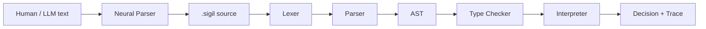

# Sigil

**A neuro-symbolic programming language** — the interface between neural perception and symbolic reasoning.

---

| **Deterministic** | **Auditable** | **AI-Native** |
|:--|:--|:--|
| Same input produces the same output, always. Non-determinism is explicit and contained behind the `neural` keyword. | Every rule evaluation produces a trace — not as a debugging feature, but as fundamental output. The trace *is* the proof. | Flat structure, ~30 keywords, constrained natural language syntax. Designed for LLMs to generate and humans to read. |

---

## What does Sigil look like?

```sigil
rule temperature_alert with priority 10:
  when sensor temperature exceeds 100
  and sensor status is :active
  then trigger alert with severity :critical
  explain "Temperature exceeded safe threshold on active sensor"
```

Sigil reads like English but parses like a formal grammar. Rules are the primary construct — each one declares *when* a condition holds and *what* to do about it, producing a full execution trace.

---

## How it works



LLMs handle the messy part — understanding natural language. Sigil handles the precise part — deterministic execution with auditable traces. The `neural` keyword is the only bridge between these two worlds.

---

## Quick start

```bash
pip install sigil-lang
```

```sigil
-- hello.sigil
define greeting as "Hello from Sigil!"

rule hello_world:
  when true
  then print greeting
  explain "This is the simplest possible Sigil program"
```

```bash
sigil run hello.sigil
```

---

| | |
|:--|:--|
| **[Getting Started](getting-started/index.md)** — Install Sigil and write your first program. | **[Language Tour](tour/index.md)** — A progressive walkthrough of every language feature. |
| **[Cookbook](cookbook/index.md)** — Guided walkthroughs of real-world examples. | **[Sigil for Python Devs](guides/sigil-for-python-devs.md)** — Side-by-side comparison for Python programmers. |
